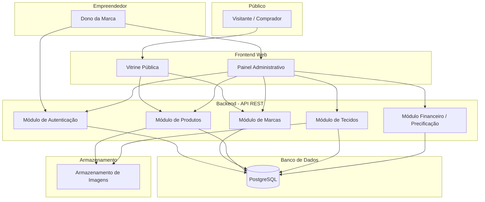
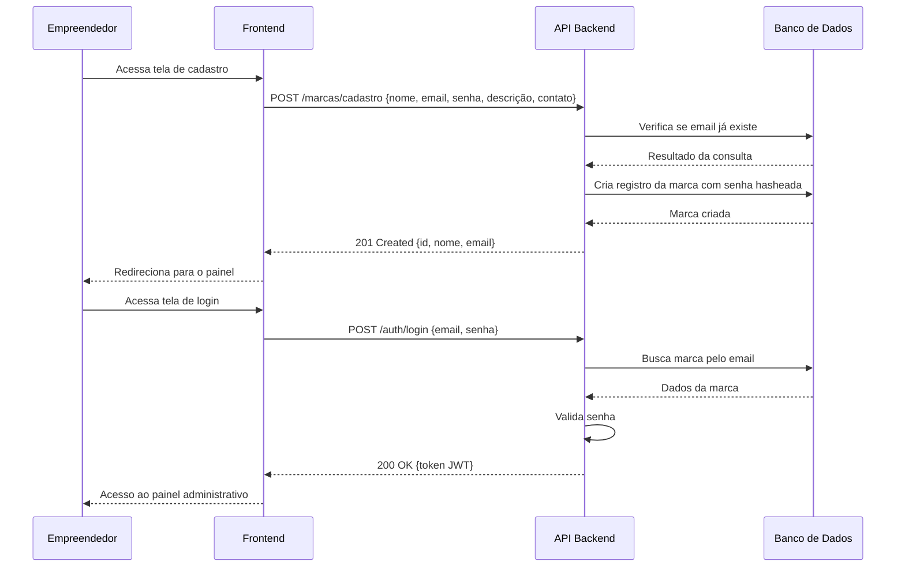
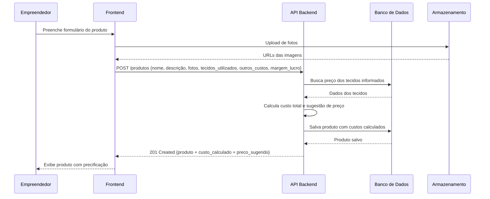
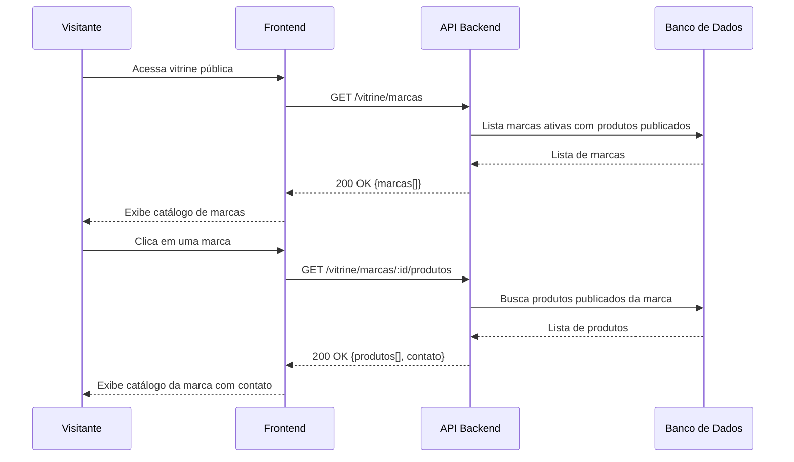
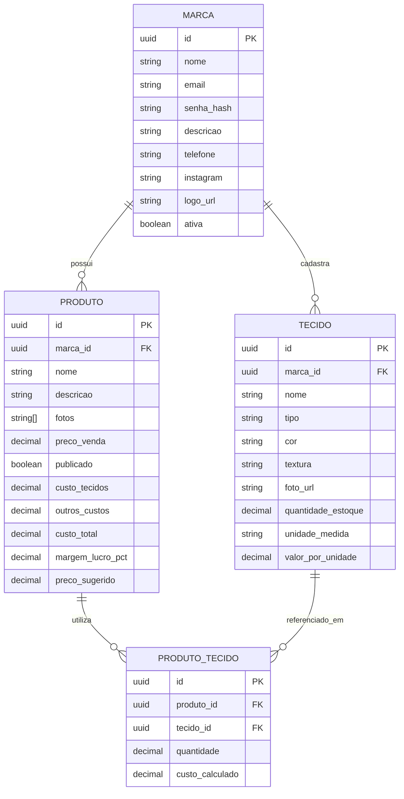

# Documento de Design: Plataforma para Pequenas Marcas de Moda

## Visão Geral

A **Plataforma para Pequenas Marcas de Moda** é um sistema web que centraliza o cadastro e a divulgação de marcas independentes de moda, a organização de produtos e tecidos, e o controle básico de custos de produção. A plataforma tem dois públicos principais: os **empreendedores** (donos de marca), que gerenciam seus produtos, tecidos e finanças em uma área administrativa privada, e o **público geral**, que acessa uma vitrine pública com o catálogo das marcas e seus produtos.

O objetivo central é oferecer uma ferramenta simples e acessível que ajude pequenos empreendedores a divulgar seus produtos, organizar seus insumos e precificar suas peças de forma fundamentada, com base no custo real dos materiais e na margem de lucro desejada.

---

## Arquitetura Geral

O sistema é dividido em três camadas principais: o frontend (interface web), o backend (API REST) e o banco de dados. A vitrine pública é acessível sem autenticação, enquanto as funções de gestão exigem login da marca.



---

## Diagramas de Fluxo por Funcionalidade

### Fluxo de Cadastro e Autenticação da Marca



### Fluxo de Cadastro de Produto com Cálculo de Custo



### Fluxo da Vitrine Pública



---

## Componentes e Interfaces

### Componente 1: Módulo de Autenticação

**Finalidade**: Gerenciar o registro, login e controle de sessão dos empreendedores.

**Interface**:
```
POST /auth/cadastro   → Cria conta da marca
POST /auth/login      → Autentica e retorna token JWT
POST /auth/logout     → Invalida sessão
GET  /auth/perfil     → Retorna dados da marca autenticada
```

**Responsabilidades**:
- Validar unicidade do email
- Hashear senhas antes de armazenar (bcrypt)
- Emitir e validar tokens JWT
- Proteger todas as rotas administrativas

---

### Componente 2: Módulo de Marcas

**Finalidade**: Gerenciar os dados cadastrais das marcas participantes.

**Interface**:
```
GET    /marcas/minha-marca        → Retorna dados da marca autenticada
PUT    /marcas/minha-marca        → Atualiza dados cadastrais
DELETE /marcas/minha-marca        → Desativa conta
GET    /vitrine/marcas            → Lista pública de marcas ativas
GET    /vitrine/marcas/:id        → Detalhes públicos de uma marca
```

**Responsabilidades**:
- Armazenar nome, descrição, informações de contato e logo da marca
- Controlar status de visibilidade (ativa/inativa)
- Separar dados sensíveis (internos) dos dados públicos

---

### Componente 3: Módulo de Produtos

**Finalidade**: Permitir o cadastro e a gestão dos produtos de cada marca.

**Interface**:
```
GET    /produtos                  → Lista produtos da marca autenticada
POST   /produtos                  → Cria novo produto
GET    /produtos/:id              → Detalhes do produto
PUT    /produtos/:id              → Atualiza produto
DELETE /produtos/:id              → Remove produto
PUT    /produtos/:id/publicar     → Alterna visibilidade pública
GET    /vitrine/marcas/:id/produtos → Lista pública de produtos de uma marca
```

**Responsabilidades**:
- Armazenar nome, descrição, fotos (URLs), preço de venda e status de publicação
- Associar tecidos utilizados e outros custos ao produto
- Armazenar o resultado do cálculo de custo e sugestão de preço
- Controlar publicação independente por produto

---

### Componente 4: Módulo de Tecidos

**Finalidade**: Gerenciar o catálogo de tecidos disponíveis da marca para uso nos produtos.

**Interface**:
```
GET    /tecidos                   → Lista tecidos da marca autenticada
POST   /tecidos                   → Cadastra novo tecido
GET    /tecidos/:id               → Detalhes do tecido
PUT    /tecidos/:id               → Atualiza tecido
DELETE /tecidos/:id               → Remove tecido
```

**Responsabilidades**:
- Armazenar tipo, cor, textura, foto, quantidade disponível e valor por unidade de medida
- Servir como base de dados para o cálculo de custo de produtos
- Pertencer exclusivamente à marca que o cadastrou

---

### Componente 5: Módulo Financeiro / Precificação

**Finalidade**: Calcular o custo de produção de uma peça e sugerir um preço de venda.

**Interface**:
```
POST /calculos/precificacao       → Calcula custo e preço sugerido (sem salvar)
```

**Responsabilidades**:
- Receber lista de tecidos utilizados (referência + quantidade) e outros custos
- Buscar preço atual dos tecidos no catálogo da marca
- Calcular custo total dos materiais
- Aplicar margem de lucro desejada para gerar sugestão de preço
- O cálculo também é executado automaticamente ao criar ou atualizar um produto

---

## Modelos de Dados

### Marca (`Marca`)

```
Marca {
  id:           UUID          (chave primária)
  nome:         String        (obrigatório, único)
  descricao:    String        (opcional)
  email:        String        (obrigatório, único)
  senha_hash:   String        (obrigatório, interno — nunca exposto)
  telefone:     String        (opcional)
  instagram:    String        (opcional)
  logo_url:     String        (opcional)
  ativa:        Boolean       (padrão: true)
  criado_em:    DateTime
  atualizado_em: DateTime
}
```

**Regras de validação**:
- `email` deve ser formato de email válido e único no sistema
- `nome` não pode ser vazio e deve ter entre 2 e 100 caracteres
- `senha` deve ter no mínimo 8 caracteres (validada antes do hash)

---

### Produto (`Produto`)

```
Produto {
  id:                 UUID        (chave primária)
  marca_id:           UUID        (chave estrangeira → Marca)
  nome:               String      (obrigatório)
  descricao:          String      (opcional)
  fotos:              String[]    (lista de URLs)
  preco_venda:        Decimal     (opcional — definido pelo empreendedor)
  publicado:          Boolean     (padrão: false)

  // Dados de custo (calculados e armazenados)
  custo_tecidos:      Decimal     (calculado)
  outros_custos:      Decimal     (informado pelo usuário)
  custo_total:        Decimal     (calculado: custo_tecidos + outros_custos)
  margem_lucro_pct:   Decimal     (percentual informado pelo usuário)
  preco_sugerido:     Decimal     (calculado: custo_total / (1 - margem_lucro_pct/100))

  criado_em:          DateTime
  atualizado_em:      DateTime
}
```

**Regras de validação**:
- `nome` obrigatório, entre 2 e 150 caracteres
- `preco_venda` deve ser positivo, se informado
- `margem_lucro_pct` deve estar entre 0 e 100 (exclusive)
- `outros_custos` deve ser ≥ 0

---

### Tecido Utilizado no Produto (`ProdutoTecido`)

```
ProdutoTecido {
  id:               UUID      (chave primária)
  produto_id:       UUID      (chave estrangeira → Produto)
  tecido_id:        UUID      (chave estrangeira → Tecido)
  quantidade:       Decimal   (obrigatório — ex: 1.5 para 1,5 metros)
  custo_calculado:  Decimal   (calculado: tecido.valor_por_unidade × quantidade)
}
```

---

### Tecido (`Tecido`)

```
Tecido {
  id:                  UUID      (chave primária)
  marca_id:            UUID      (chave estrangeira → Marca)
  nome:                String    (obrigatório)
  tipo:                String    (ex: algodão, linho, malha)
  cor:                 String    (opcional)
  textura:             String    (opcional)
  foto_url:            String    (opcional)
  quantidade_estoque:  Decimal   (obrigatório, ≥ 0)
  unidade_medida:      Enum      (metro | kg | unidade)
  valor_por_unidade:   Decimal   (obrigatório, > 0)
  criado_em:           DateTime
  atualizado_em:       DateTime
}
```

**Regras de validação**:
- `nome` obrigatório, entre 2 e 100 caracteres
- `valor_por_unidade` deve ser maior que zero
- `quantidade_estoque` deve ser ≥ 0
- `unidade_medida` deve ser um dos valores do enum

---

## Lógica de Precificação

A regra de cálculo de custo e sugestão de preço segue o seguinte algoritmo:

```
DADO uma lista de tecidos_utilizados [(tecido_id, quantidade), ...]
     E outros_custos (valor fixo adicional)
     E margem_lucro_pct (percentual de margem desejada)

CALCULAR:
  custo_tecidos    = Σ (tecido.valor_por_unidade × quantidade) para cada tecido utilizado
  custo_total      = custo_tecidos + outros_custos
  preco_sugerido   = custo_total / (1 - margem_lucro_pct / 100)

EXEMPLO:
  Tecido A: R$ 30,00/m × 1,5 m = R$ 45,00
  Outros custos: R$ 20,00
  custo_total = R$ 65,00
  Margem de lucro: 40%
  preco_sugerido = 65,00 / (1 - 0,40) = 65,00 / 0,60 = R$ 108,33
```

**Condição de guarda**: se `margem_lucro_pct` for igual a 100, o sistema deve retornar erro de validação (divisão por zero).

---

## Modelo de Relacionamentos (ER Simplificado)



---

## Tratamento de Erros

### Cenário 1: Email já cadastrado

**Condição**: Tentativa de cadastro com email já existente no sistema  
**Resposta**: HTTP 409 Conflict com mensagem `"Este email já está cadastrado."`  
**Recuperação**: Usuário é orientado a usar outro email ou recuperar a senha

### Cenário 2: Tecido não encontrado no cálculo

**Condição**: `tecido_id` informado na criação de produto não existe ou não pertence à marca  
**Resposta**: HTTP 422 Unprocessable Entity com mensagem `"Tecido não encontrado: {id}"`  
**Recuperação**: Usuário deve verificar o catálogo de tecidos e informar IDs válidos

### Cenário 3: Margem de lucro inválida

**Condição**: `margem_lucro_pct` igual a 100 (divisão por zero no cálculo)  
**Resposta**: HTTP 400 Bad Request com mensagem `"A margem de lucro não pode ser 100%."`  
**Recuperação**: Usuário deve informar um valor entre 0 e 99,99

### Cenário 4: Produto não publicado acessado na vitrine

**Condição**: Visitante tenta acessar produto com `publicado = false` via rota pública  
**Resposta**: HTTP 404 Not Found  
**Recuperação**: Sem ação necessária — comportamento esperado

### Cenário 5: Acesso não autorizado ao painel

**Condição**: Requisição a rota protegida sem token JWT ou com token expirado  
**Resposta**: HTTP 401 Unauthorized  
**Recuperação**: Usuário é redirecionado para a tela de login

---

## Estratégia de Testes

### Testes Unitários

- Cálculo de custo e sugestão de preço (módulo financeiro)
- Validações de modelos (email, margem de lucro, valores obrigatórios)
- Lógica de hash e verificação de senha

### Testes Baseados em Propriedades

**Biblioteca sugerida**: fast-check (JavaScript/TypeScript) ou Hypothesis (Python)

Propriedades a verificar:
- Para qualquer lista de tecidos com quantidades positivas e margem entre 0 e 99,99%, o `preco_sugerido` deve ser sempre maior que o `custo_total`
- Para qualquer combinação válida de insumos, `custo_total = custo_tecidos + outros_custos`
- `preco_sugerido` deve crescer monotonicamente à medida que a margem de lucro aumenta

### Testes de Integração

- Fluxo completo de cadastro → login → criação de tecido → criação de produto com cálculo
- Publicação de produto e verificação de aparecimento na vitrine pública
- Isolamento de dados: produto de uma marca não aparece no painel de outra

---

## Considerações de Segurança

- Senhas armazenadas com **bcrypt** (custo mínimo 12)
- Autenticação via **JWT** com expiração configurável (sugerido: 8 horas)
- Rotas administrativas protegidas por middleware de autenticação
- Dados de uma marca acessíveis apenas pela própria marca autenticada (multi-tenancy por `marca_id`)
- Upload de imagens restrito por tipo MIME (apenas `image/jpeg`, `image/png`, `image/webp`) e tamanho máximo (5 MB por arquivo)
- Vitrine pública expõe apenas campos não sensíveis (sem email, senha, dados internos)

---

## Dependências Principais

| Categoria              | Sugestão                                   |
|------------------------|--------------------------------------------|
| Backend (API REST)     | Node.js + Express ou NestJS / Python FastAPI |
| Banco de dados         | PostgreSQL                                 |
| ORM                    | Prisma (Node.js) ou SQLAlchemy (Python)    |
| Autenticação           | JWT (jsonwebtoken / PyJWT)                 |
| Hash de senha          | bcrypt                                     |
| Armazenamento de imagens | AWS S3 ou Cloudflare R2                  |
| Frontend               | React ou Next.js                           |
| Testes (PBT)           | fast-check (TS) ou Hypothesis (Python)     |
